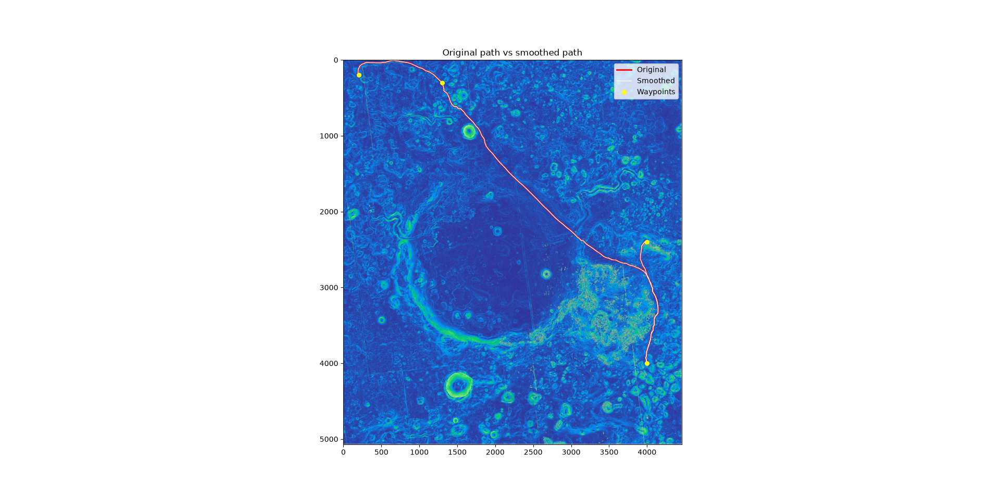
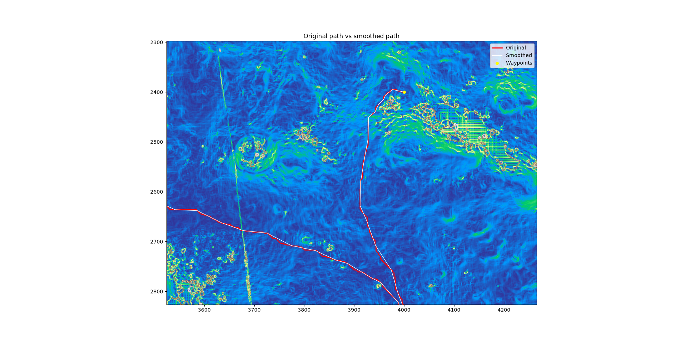
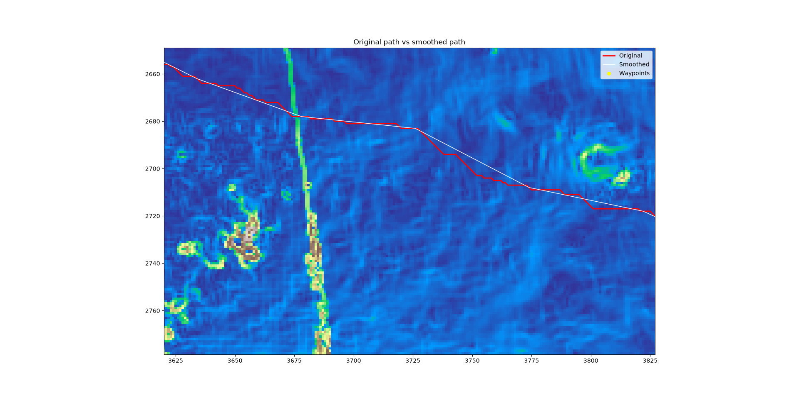

<div align="center">

# RED ODYSSEY

### Martian Terrain Explorer

*Making Martian terrain understandable.*

<p>
  <a href="https://github.com/nczeta/red-odyssey"></a>
  
  
</p>

<p>
  
  
  
  
  
  
</p>

[Overview](#overview) · [How it works](#how-it-works) · [Layers](#layers) · [Terrain analysis](#terrain-analysis) · [Route planning](#route-planning) · [Tech stack](#tech-stack) · [Usage](#usage) · [Sources](#sources-and-credits) · [Team](#team)

</div>

---

## Overview

Exploring a planet means understanding not only its landmarks, but also the terrain that connects them.

**Red Odyssey** is an interactive planetary exploration platform focused on the Martian surface, built for the **NASA Space Apps Challenge 2026**. It combines orbital imagery, topographic data and geospatial analysis in a single environment, so users can investigate the landscape of **Jezero Crater**, compare spatial information and explore how topography influences possible exploration routes.

## How it works

1. **Planetary observations.** Orbital imagery and elevation datasets are collected and integrated into a detailed representation of the Martian surface.
2. **GIS and terrain processing.** Data is processed, coordinate systems are aligned and terrain information is derived with QGIS and Python.
3. **Geospatial layers.** Imagery, elevation models and derived products are organised into interoperable map layers.
4. **Interactive exploration.** The landscape is explored through OpenLayers, with navigation, layer management and spatial inspection.
5. **Route planning.** Pathfinding algorithms evaluate terrain costs and identify possible exploration routes.

## Layers

Five complementary views of Jezero Crater:

| # | Layer | What it shows | Source | Resolution |
|---|-------|---------------|--------|------------|
| 01 | **Orbital Imagery & Hillshade** | CTX orthomosaic, plus a multidirectional hillshade that reveals surface morphology through simulated illumination | [CTX orthomosaic](https://planetarymaps.usgs.gov/mosaic/mars2020_trn/CTX/ScienceInvestigationMaps_JPL/M20_JezeroCrater_CTXortho_mosaic_5m.tif), USGS Astrogeology | 5 m/px imagery, 20 m/px hillshade |
| 02 | **Digital Elevation Model** | Surface elevation in metres, the foundation for all derived products | [CTX DEM](https://planetarymaps.usgs.gov/mosaic/mars2020_trn/CTX/ScienceInvestigationMaps_JPL/M20_JezeroCrater_CTXDEM_20m.tif), USGS Astrogeology | 20 m/px |
| 03 | **Contour Lines** | Lines of equal elevation at 200 m intervals, generated in QGIS | Derived from the DEM | 200 m interval |
| 04 | **Scientific Sites** | Reference points selected for their scientific relevance | NASA Space Apps 2026 materials, [USGS ArcGIS web app](https://usgs.maps.arcgis.com/apps/webappviewer/index.html?id=a0ae4b521f7a4a6ca2cf0f0c551d5293) | n/a |
| 05 | **Slope Map** | Surface inclination in degrees: lighter areas are gentler, darker areas are steeper | Derived from the DEM in QGIS | 20 m/px |

## Terrain analysis

All terrain products come from the 20 m/px CTX Digital Elevation Model and are derived in QGIS: **hillshade**, **contour lines** and **slope**. The hillshade is an aid to reading morphology, not a photograph and not real lighting.

> [!WARNING]
> **Terrain interpretation is not a safety certification.** These products describe selected topographic properties of the study area. They do not, on their own, establish rover traversability, route safety or operational suitability.

## Route planning

Given a start point and a destination, Red Odyssey looks for a route that accounts for the shape of the terrain, and returns a geographic route with metrics such as distance and elevation change.

```text
JavaScript interface (OpenLayers)
            │
            ▼
      FastAPI service
            │
            ▼
Python processing (slope, cost, pathfinding)
            │
            ▼
   Geographic route output
```

**Cost model (current defaults).** Slope is computed from the DEM with Horn's method over the 8 neighbours of each pixel. Cells steeper than a maximum slope (20°) are treated as impassable. In the remaining cells, the cost of a step is

```
cost = distance × (1 + (tan θ / tan θ₀)²)
```

where `θ₀` is a reference slope derived from a detour factor `K` (default 5): the router accepts a path up to about `K` times longer to avoid the steepest traversable terrain. Slope therefore only adds cost below the limit, and above it the cell is a hard barrier.

### Path smoothing

The pathfinder moves between neighbouring pixels of the 20 m/px grid, so the raw route follows the grid and shows small staircase steps. For a cleaner geometry the route can be smoothed. The figures below compare the **original path** (red) with the **smoothed path** (white) over the slope map, where bluer areas are gentler and green to brown areas are steeper. Yellow dots are the waypoints, and the axes are DEM pixel coordinates (column on x, row on y).

<p align="center">
  
  <br>
  <em>Full view of the route across Jezero Crater. At this scale the two paths are almost indistinguishable.</em>
</p>

<p align="center">
  
  <br>
  <em>Zoom on a stretch of the route (columns 3550 to 4250, rows 2300 to 2800). The smoothed path follows the same corridor and only trims small detours.</em>
</p>

<p align="center">
  
  <br>
  <em>Pixel-level zoom (about 200 px wide, roughly 4 km at 20 m/px). The original path steps along the grid cells, while the smoothed path replaces the steps with straight segments.</em>
</p>

Smoothing is applied for readability and display. It shifts the route by only a few pixels, so the overall corridor stays the same.

## Tech stack

| Tool | Role |
|------|------|
| **OpenLayers** | Map rendering, interactions and layer management |
| **JavaScript** | Native ES modules, shared page components and application state |
| **Vite** | Local development and a three-page production build |
| **QGIS** | Hillshade, contour extraction and slope analysis |
| **Python** | Terrain processing and route-cost analysis |
| **FastAPI** | Interface between the explorer and the Python routing |

AI tools were used along the way: Codex for building the web application, and ChatGPT for brainstorming, technical research, learning new technologies and supporting architectural and design decisions.

## Usage

### Prerequisites

- [Git](https://git-scm.com/)
- [Node.js](https://nodejs.org/) (LTS) and npm
- [Python](https://www.python.org/) 3.10 or newer (only for the routing backend)

### 1. Clone the repository

```bash
git clone https://github.com/nczeta/red-odyssey.git
cd red-odyssey
```

### 2. Run the web app

```bash
npm install
npm run dev
```

Vite prints a local address (usually `http://localhost:5173`). The app has three pages: the landing page (`index.html`), the explorer (`app.html`) and this documentation (`project.html`).

To create a production build and preview it:

```bash
npm run build
npm run preview
```

### 3. Run the routing backend

Create a virtual environment and install the dependencies:

```bash
python -m venv .venv
source .venv/bin/activate        # Windows: .venv\Scripts\activate
pip install numpy rasterio scikit-image matplotlib fastapi "uvicorn[standard]"
```

Download the [CTX DEM](https://planetarymaps.usgs.gov/mosaic/mars2020_trn/CTX/ScienceInvestigationMaps_JPL/M20_JezeroCrater_CTXDEM_20m.tif) and place it in the `assets/` folder:

```
assets/M20_JezeroCrater_CTXDEM_20m.tif
```

Start the API from the repository root:

```bash
uvicorn backend.main:app --reload
```

FastAPI serves interactive API docs at `http://127.0.0.1:8000/docs`.

## Sources and credits

Red Odyssey uses CTX orbital imagery and elevation data of Jezero Crater provided by **USGS Astrogeology**. Hillshade, contour lines and slope maps are derived from the original elevation model in QGIS. The Scientific Sites layer is based on materials provided for the NASA Space Apps Challenge 2026 and on the USGS ArcGIS geographic reference.

- [NASA, Mars exploration](https://science.nasa.gov/mars/)
- [NASA, Planetary Data System](https://pds.nasa.gov/)

Typography: IBM Plex Sans Condensed and Inter, distributed locally under their accompanying font licenses.

## Team

- Niccolò Zampini
- Karim Omar Zoubir
- Filippo Pavone
- Pietro Adami Martinez
- Shenal Ferdin Croos Warnakulasuriya
- Alessio Parolini

---

<div align="center">

*Independent educational project, developed for the NASA Space Apps Challenge 2026. It is not affiliated with, approved or endorsed by NASA or USGS.*

</div>
